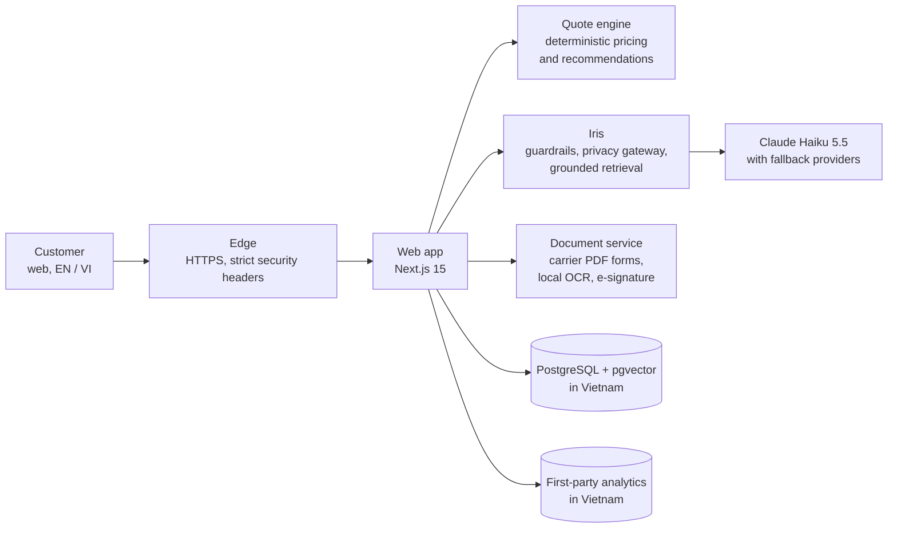

# Insurnao

**An AI-powered digital insurance agency for Vietnam: travel and health insurance today (property and vehicle coming soon).**

Needs analysis, cross-carrier comparison, the carrier's own application form and e-signature in one bilingual journey, guided by **Iris**, an AI assistant that explains cover in plain language, cites its sources and never sets a price.

[insurnao.ai](https://insurnao.ai) · Public launch **9 November 2026**

> This is the public overview of Insurnao. The product source code is private.

---

## Why Insurnao

**The problem.** Buying travel or health insurance in Vietnam is still a paper-and-PDF exercise. Plans are spread across carrier brochures, benefit schedules and policy wordings in mixed languages; international plans are priced in USD; applications are carrier-specific forms that customers fill in by hand and sign in ink. Comparing like for like across carriers is slow, and plain-language advice is hard to find at the moment of decision.

**What Insurnao does.** One guided journey: a short needs analysis, a ranked comparison of real plans from established carriers, and the carrier's own application form prefilled from the customer's answers, checked, e-signed and handed to the carrier. Iris answers questions along the way, in English or Vietnamese, with citations to the carrier's own documents.

**Why it is defensible.**

| Advantage | What it means in practice |
| --- | --- |
| **AI where it helps, determinism where it matters** | Iris explains, retrieves and cites. A deterministic engine produces every price and every recommendation, with a recorded decision log. The model never gets the final say. |
| **Agency model** | Insurnao is a licensed insurance agency. Carriers underwrite, price and bind; Insurnao carries no underwriting risk and focuses on distribution, advice and service. |
| **Data residency by design** | The full platform runs on GreenNode (VNG Cloud) in Ho Chi Minh City. Personal data is stored and processed in Vietnam, aligned with the Personal Data Protection Law (Law 91/2025/QH15) and Decree 356/2025. |
| **Carrier data as an asset** | Rates and benefits are transcribed verbatim from dated carrier documents and verified against carriers' own calculators. Adding a carrier is data work, not a rewrite. |
| **A learning loop that stays in Vietnam** | First-party, consent-based analytics record what was recommended and what customers chose, building the training data for an ML recommender without any third-party analytics service. |

---

## Product

| Line of business | Status | Carriers |
| --- | --- | --- |
| Travel | **Live**: quote, compare, apply, e-sign, track | PVI, BIC, PTI, PJICO, Liberty, Pacific Cross International |
| Health | **Live**: international and local plans, family quotes | Pacific Cross International, Allianz Care, April (via PVI), Liberty, PVI, BIC, PTI |
| Property | Coming soon | |
| Vehicle | Coming soon | |

- **Phone-first onboarding.** Sign up and log in with a phone number and one-time code.
- **Carrier-authoritative applications.** Needs-analysis answers prefill the carrier's own application, field for field. The experience is redesigned; the carrier's form never is.
- **Iris.** A grounded EN/VI assistant with citations, deterministic guardrails and a privacy gateway.
- **Ops console.** Lead funnel, case management with a human-approval gate before anything reaches a carrier, document review and agent management.

---

## Milestones

| When | Milestone |
| --- | --- |
| May 2026 | Build starts: TypeScript monorepo, carrier data ingestion, quote engine |
| Jul 2026 | Full platform moved in-country to GreenNode in Ho Chi Minh City |
| Aug 2026 | Supply-chain security controls and CI on every change |
| Sep 2026 | Iris knowledge base expanded to 270 source documents across travel, health and regulation |
| Oct 2026 | Iris on Claude Haiku 5.5 after a blind 12-model benchmark; first-party analytics in Vietnam |
| Oct to Nov 2026 | Quiet beta |
| **9 Nov 2026** | **Public launch** at [insurnao.ai](https://insurnao.ai) |

---

## Architecture

- Everything that touches personal data runs in Vietnam. Questions to Iris that contain personal data never leave the country verbatim.
- Containerised services, images pinned by digest, health-gated deploys with automatic rollback.

---

## Tech stack

| Layer | Technology |
| --- | --- |
| Languages | TypeScript (strict) across the platform; Python for the document service |
| Monorepo | pnpm workspaces, Turborepo, Biome |
| Web | Next.js 15 App Router, React 19, Tailwind CSS, next-intl (Vietnamese and English) |
| Validation | Zod |
| Data | PostgreSQL 17 + pgvector, Drizzle ORM |
| Cache and counters | Redis 7 |
| Auth | Phone OTP sessions; WebAuthn passkeys for operations |
| Documents | pdf-lib (TypeScript); pypdf, ReportLab, OpenCV, Tesseract (Python) |
| AI | Anthropic Claude Haiku 5.5 with prompt caching; OpenRouter fallback restricted to no-data-retention providers |
| Edge | Caddy |
| Hosting | Docker Compose on GreenNode (VNG Cloud), Ho Chi Minh City |
| Delivery | GitHub Actions, GitHub Container Registry |
| Security tooling | Semgrep, Gitleaks, Trivy, OSV-Scanner, Dependabot |
| Monitoring | Uptime Kuma, self-hosted ntfy |
| Planned | Metabase (BI), GrowthBook (experiments), Langfuse (LLM tracing), DuckDB and scikit-learn / LightGBM (ML recommender) |

---

## Iris, the AI assistant

Iris answers questions about insurance, Vietnamese insurance regulation, products, the buying journey and troubleshooting, in English and Vietnamese.

- **Grounded:** answers come from a verified knowledge base of carrier and regulatory documents, with citations.
- **Guardrailed:** deterministic rules run before and after every model call; Iris never makes underwriting decisions, guarantees prices or gives personal legal or financial advice.
- **Private:** a privacy gateway keeps personal data in Vietnam.
- **Cost-governed:** hard daily spend limits and abuse protection are built in.
- **Continuously evaluated:** a 5,600-question adversarial bank in English and Vietnamese (tricky questions, prompt injection, multi-turn traps) is answered and graded every night by an independent AI judge, and every failure becomes a lesson. In a blind benchmark of 12 models, Claude Haiku 5.5 scored highest, with zero critical failures.

---

## Quote engine

- **Every price is deterministic.** No AI writes, edits or rounds a premium.
- **Verified against carriers.** Rate tables are cross-checked against carriers' own calculators (for example, 32 of 32 cases matched exactly for one international health product) and swept across more than 1,600 travel and health combinations.
- **Explainable.** Every recommendation records why it was made, and later what the customer chose.
- **VND first.** USD-priced plans convert at the Vietcombank sell rate at quote time.

---

## Security, privacy and quality

- **Compliance:** built for Vietnam's PDPL (Law 91/2025/QH15) and Decree 356/2025: data residency in Vietnam, consent before analytics, pseudonymous product data, enforced retention.
- **Security engineering:** static analysis, secret scanning, dependency and container scanning on every change; supply-chain controls on every dependency; security gates before any code reaches production.
- **Quality:** about 280 automated test suites (quote engine, recommender, Iris, applications, e-signature, analytics, database), plus document-processing fail-safe tests and real-database migration replays in CI.
- **Operations:** encrypted in-country backups with regular restore drills, uptime monitoring and alerting.

---

## Roadmap

**Done:** travel and health journeys end to end · in-country production · Iris with privacy gateway and nightly evaluation · first-party analytics in Vietnam

**Next:** quiet beta, then public launch on 9 November 2026

**Planned:** property and vehicle insurance · ML-powered recommendations from real customer outcomes · self-hosted business intelligence · experiments and feature flags

---

## Principles

- Insurnao does not underwrite. Carriers decide.
- The AI never sets a price.
- Carrier data is recorded exactly as published.
- Nothing is sent to a carrier without human approval.
- Personal data stays in Vietnam.

---

## Contact

Carriers, partners and investors: **[hello@insurnao.ai](mailto:hello@insurnao.ai)**

Insurnao is a brand of **Red Horizon Holdings**. © 2026 Red Horizon Holdings. All rights reserved.
