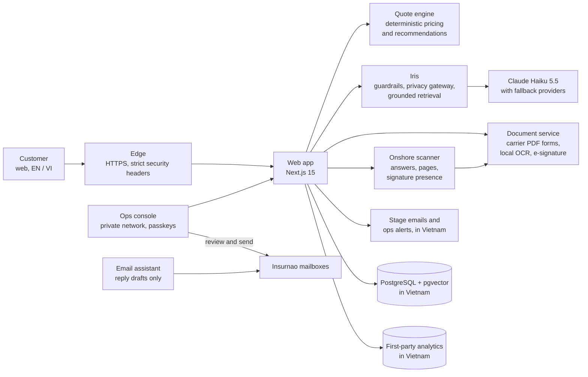

# Insurnao

**A licensed insurance agency performing brokerage services (VSIC 6622), powered by AI, for Vietnam: travel and health insurance today (property and vehicle coming soon).**

Needs analysis, cross-carrier comparison, the carrier's own application form and e-signature in one bilingual journey, guided by **Iris**, an AI assistant that explains cover in plain language, cites its sources and never sets a price.

[insurnao.ai](https://insurnao.ai) · Public launch **9 November 2026**

> This is the public overview of Insurnao. The product source code is private.

---

## Why Insurnao

**The problem.** Buying travel or health insurance in Vietnam is still a paper-and-PDF exercise. Plans are spread across carrier brochures, benefit schedules and policy wordings in mixed languages; international plans are priced in USD; applications are carrier-specific forms that customers fill in by hand and sign in ink. Comparing like for like across carriers is slow, and plain-language advice is hard to find at the moment of decision.

**What Insurnao does.** One guided journey: a short needs analysis, a ranked comparison of real plans from established carriers, and the carrier's own application form prefilled from the customer's answers, checked, e-signed and handed to the carrier. Iris answers questions along the way, in English or Vietnamese, with citations to the carrier's own documents.

**Why it is defensible.**

| Advantage | What it means in practice |
| --- | --- |
| **AI where it helps, determinism where it matters** | Iris explains, retrieves and cites. A deterministic engine produces every price and every recommendation, with a recorded decision log. The model never gets the final say. |
| **Agency model** | Insurnao is a licensed insurance agency performing brokerage services (VSIC 6622). Carriers underwrite, price and bind; Insurnao carries no underwriting risk and focuses on distribution, advice and service. |
| **Data residency by design** | The full platform runs on GreenNode (VNG Cloud) in Ho Chi Minh City. Personal data is stored and processed in Vietnam, aligned with the Personal Data Protection Law (Law 91/2025/QH15) and Decree 356/2025. |
| **Carrier data as an asset** | Rates and benefits are transcribed verbatim from dated carrier documents and verified against carriers' own calculators. Adding a carrier is data work, not a rewrite. |
| **A learning loop that stays in Vietnam** | First-party, consent-based analytics record what was recommended and what customers chose, building the training data for an ML recommender without any third-party analytics service. |

---

## Product

| Line of business | Status | Carriers |
| --- | --- | --- |
| Travel | **Live**: quote, compare, apply, e-sign, track (single trip and annual, domestic and international) | PVI, BIC, PTI, PJICO, Liberty, Pacific Cross International |
| Health | **Live**: quote, compare, apply, e-sign, track (international and local plans, individuals and families) | Pacific Cross International, Allianz Care, April (via PVI), Liberty, PVI, BIC, PTI |
| Property | Coming soon | |
| Vehicle | Coming soon | |

Travel and health follow the same journey: needs analysis, side-by-side comparison, the carrier's own application prefilled from the customer's answers, signing, team review before anything reaches the carrier, and case tracking. Health asks for more (insured persons, medical declarations), so its application has more steps. Where a carrier's form is not yet available for online self-service, the Insurnao team completes the application with the customer.

- **Phone-first onboarding.** Sign up and log in with a phone number and one-time code.
- **Carrier-authoritative applications.** Needs-analysis answers prefill the carrier's own application, field for field. The experience is redesigned; the carrier's form never is.
- **Iris.** A grounded EN/VI assistant with citations, deterministic guardrails and a privacy gateway. Iris also gives each application a quick check before the insurer's form is prepared.
- **Upload, onshore scanner and human review.** The signed application is uploaded with recorded consent, checked by a scanner that runs in Vietnam (answers, pages, signature, text recognition for scans), then reviewed by a person before anything reaches the insurer. See [From application to insurer](#from-application-to-insurer).
- **Stage emails and alerts.** Customers get a short email at each stage from Insurnao's own mailbox in Vietnam, with no insurance details in it. The team gets a phone alert and an email when an application arrives.
- **Ops console.** One place to run the agency: a daily to-do list, case management with the application review (every original beside the scanner's findings) and a human-approval gate before anything reaches a carrier, an email manager for every mailbox, payment-proof checks (customers always pay the insurer directly), renewals, the insurer address book, website enquiries, privacy requests, team invites, a live insights dashboard and a built-in user manual. Reachable only on a private network, with a passkey per person, and every sensitive action is logged.
- **AI email assistant.** Reads Insurnao's mailboxes and, with Claude Sonnet 5.5, works out what each sender is asking and leaves a suggested reply in the mailbox's drafts, in the sender's language, answered from Iris's verified product facts. It never sends: a person reviews, edits and sends every reply from the ops email manager. Personal details are replaced with placeholders before any text reaches the AI model, and sensitive emails (health, data requests, complaints) never reach it at all.

---

## Milestones

| When | Milestone |
| --- | --- |
| May 2026 | Build starts: TypeScript monorepo, carrier data ingestion, quote engine |
| Jul 2026 | Full platform moved in-country to GreenNode in Ho Chi Minh City |
| Aug 2026 | Supply-chain security controls and CI on every change |
| Sep 2026 | Iris knowledge base expanded to 270 source documents across travel, health and regulation |
| Oct 2026 | Iris on Claude Haiku 5.5 after a blind 12-model benchmark; first-party analytics in Vietnam |
| 20 Oct 2026 | Soft launch at insurnao.ai; ops console reorganised, live insights dashboard, anonymous crash tracking, AI email assistant and ops email manager, public status page |
| 22 Oct 2026 | Live end-to-end test runs on the production site with synthetic customers: application upload, onshore scanner, team review, correction loop, send to insurer, every email, and six browser profiles |
| Oct to Nov 2026 | Quiet beta |
| **9 Nov 2026** | **Public launch** at [insurnao.ai](https://insurnao.ai) |

---

## Architecture

- Everything that touches personal data runs in Vietnam. Questions to Iris that contain personal data never leave the country verbatim.
- Containerised services, images pinned by digest, health-gated deploys with automatic rollback.

---

## From application to insurer

What happens after a customer picks a plan. Every step runs in Vietnam, and none of them decides on cover: the insurer does.

1. **Details and a quick check.** Answers from the needs analysis prefill the application. Simple rules, and for travel a privacy-light AI check that sees only ages, countries and yes/no flags (never names or ID numbers), point out anything that looks off.
2. **The insurer's own form.** It is filled in on our servers and shown page by page in the browser, so the customer sees exactly what the insurer will receive, then signs it.
3. **Consent, then upload.** Two recorded steps: permission to collect the application, then permission for this exact application to go to the chosen insurer. Uploads are resumable, each file is fingerprinted, and files that are not what they claim to be (a renamed file, a password-protected PDF) are turned away with a plain explanation.
4. **The onshore scanner.** Right after submission it compares every answer with the confirmed details, checks that every page is there, looks for ink on the insurer's signature line (presence only, never authenticity) and reads scans with local text recognition in English and Vietnamese. Photos are always marked for a person to compare. Its findings are suggestions, never decisions.
5. **A person reviews every original.** The team confirms or corrects each finding. Overriding a scanner warning needs a written reason. If anything needs fixing, the customer is emailed and uploads a corrected copy.
6. **Sent by a person.** Only after a full review, only to an address in that insurer's address book, with a short checklist and a record of exactly what was sent.

On 22 October 2026 this whole path was run live with synthetic customers, including ten deliberately altered uploads (unsigned, name changed, dates extended, a page missing, plan switched, another application's form, a photo, a renamed text file, a password-protected PDF). The scanner and the review caught them, the correction loop and every customer email worked, and the journey passed in Edge, Chrome, Firefox, Safari and two iPhone sizes, signed in and as a guest. The few gaps it found were fixed the same day.

---

## Tech stack

| Layer | Technology |
| --- | --- |
| Languages | TypeScript (strict) across the platform; Python for the document service |
| Monorepo | pnpm workspaces, Turborepo, Biome |
| Web | Next.js 15 App Router, React 19, Tailwind CSS, next-intl (Vietnamese and English) |
| Validation | Zod |
| Data | PostgreSQL 17 + pgvector, Drizzle ORM |
| Cache and counters | Redis 7 |
| Auth | Phone OTP sessions; WebAuthn passkeys for operations |
| Documents | pdf-lib (TypeScript); PDF.js for in-browser previews; pypdf, ReportLab, OpenCV, Poppler, Tesseract in English and Vietnamese (Python) for form filling, text recognition, page checks and the signature check |
| AI | Anthropic Claude Haiku 5.5 with prompt caching for Iris and the application check; Claude Sonnet 5.5 for the email assistant and for grading Iris's nightly tests; OpenRouter fallback restricted to no-data-retention providers |
| Email | Our own mail host for every mailbox, customer stage emails and team alerts; IMAP for the email assistant and ops email manager |
| Edge | Caddy |
| Hosting | Docker Compose on GreenNode (VNG Cloud), Ho Chi Minh City |
| Delivery | GitHub Actions, GitHub Container Registry |
| Security tooling | Semgrep, Gitleaks, Trivy, OSV-Scanner, Dependabot |
| Monitoring | Uptime Kuma with a public status page ([status.insurnao.ai](https://status.insurnao.ai)), self-hosted ntfy alerts, live in-house insights dashboard |
| Testing | About 310 automated test suites; Playwright for live journeys in Edge, Chrome, Firefox, Safari (WebKit) and iPhone profiles |
| Planned | Metabase (BI), GrowthBook (experiments), Langfuse (LLM tracing), DuckDB and scikit-learn / LightGBM (ML recommender) |

---

## Iris, the AI assistant

Iris answers questions about insurance, Vietnamese insurance regulation, products, the buying journey and troubleshooting, in English and Vietnamese.

- **Grounded:** answers come from a verified knowledge base of carrier and regulatory documents, with citations.
- **Guardrailed:** deterministic rules run before and after every model call; Iris never makes underwriting decisions, guarantees prices or gives personal legal or financial advice.
- **Private:** a privacy gateway keeps personal data in Vietnam.
- **Cost-governed:** hard daily spend limits and abuse protection are built in.
- **Continuously evaluated:** a 5,600-question adversarial bank in English and Vietnamese (tricky questions, prompt injection, multi-turn traps) is answered and graded every night by an independent AI judge, and every failure becomes a lesson. In a blind benchmark of 12 models, Claude Haiku 5.5 scored highest, with zero critical failures.

---

## Quote engine

- **Every price is deterministic.** No AI writes, edits or rounds a premium.
- **Verified against carriers.** Rate tables are cross-checked against carriers' own calculators (for example, 32 of 32 cases matched exactly for one international health product) and swept across more than 1,600 travel and health combinations.
- **Explainable.** Every recommendation records why it was made, and later what the customer chose.
- **VND first.** USD-priced plans convert at the Vietcombank sell rate at quote time.

---

## Security, privacy and quality

- **Compliance:** built for Vietnam's PDPL (Law 91/2025/QH15) and Decree 356/2025: data residency in Vietnam, consent before analytics, pseudonymous product data, enforced retention. Visitors who decline analytics are only counted anonymously; browser crashes are counted for everyone the same anonymous way, with no personal data.
- **Security engineering:** static analysis, secret scanning, dependency and container scanning on every change; supply-chain controls on every dependency; security gates before any code reaches production.
- **Quality:** about 310 automated test suites (quote engine, recommender, Iris, applications, upload and scanner, e-signature, emails, analytics, database), plus document-processing fail-safe tests, real-database migration replays in CI, and live end-to-end runs on the production site with synthetic customers.
- **Operations:** encrypted in-country backups with regular restore drills, minute-by-minute uptime checks on a [public status page](https://status.insurnao.ai), crash alerts and a live insights dashboard.

---

## Roadmap

**Done:** travel and health journeys end to end · in-country production · Iris with privacy gateway and nightly evaluation · first-party analytics in Vietnam · soft launch · ops console and live insights · AI email assistant with human review · application upload with onshore scanner, team review and send gate · stage emails and team alerts · live end-to-end runs across browsers

**Next:** quiet beta, then public launch on 9 November 2026

**Planned:** property and vehicle insurance · ML-powered recommendations from real customer outcomes · self-hosted business intelligence · experiments and feature flags

---

## Principles

- Insurnao does not underwrite. Carriers decide.
- The AI never sets a price.
- Machines suggest; people decide. Scanner and AI findings are always checked by a person.
- Carrier data is recorded exactly as published.
- Nothing is sent to a carrier without human approval, and AI-drafted emails are always reviewed by a person before sending.
- Personal data stays in Vietnam.

---

## Contact

Carriers, partners and investors: **[hello@insurnao.ai](mailto:hello@insurnao.ai)**

Insurnao is a brand of **Red Horizon Holdings**. © 2026 Red Horizon Holdings. All rights reserved.
